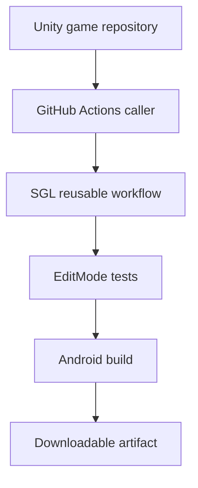

# SGL Unity CI/CD

Reusable GitHub Actions workflows for Unity Android games by SGL Games. Includes an optional Google Play Internal Testing upload workflow.

> Status: starter template. Not yet validated against a real Unity game.

## Features
- Central reusable GitHub Actions workflow
- Optional GameCI EditMode tests
- Android APK build and downloadable artifact
- Optional signed Android AAB build
- Credentials stored in each game's GitHub Actions Secrets

## Architecture

## Quick start

1. Copy `examples/unity-project/.github/workflows/ci.yml` to `.github/workflows/ci.yml` in your Unity game's repository.
2. Set `unity_version` to the value in `ProjectSettings/ProjectVersion.txt`; customize `build_name`.
3. Add Unity activation credentials to the **game repository** under Settings → Secrets and variables → Actions. See [GameCI activation](https://game.ci/docs/github/activation).
4. Push to GitHub and inspect Actions. Start with `build_aab: false`.
5. For signed AABs, configure Android signing secrets and set `build_aab: true`.

## Secret names

| Name | Purpose |
| --- | --- |
| `UNITY_LICENSE` | Unity license string (if required) |
| `UNITY_EMAIL` | Unity activation email (if required) |
| `UNITY_PASSWORD` | Unity activation password (if required) |
| `ANDROID_KEYSTORE_BASE64` | Base64-encoded Android upload keystore |
| `ANDROID_KEYSTORE_PASSWORD` | Keystore password |
| `ANDROID_KEYALIAS_NAME` | Signing alias |
| `ANDROID_KEYALIAS_PASSWORD` | Signing key password |

Never commit secret values. GitHub generally withholds secrets from fork pull requests. Restrict privileged workflow access and pin third-party Actions to full commit SHAs before production use.

## Known limitations

- The pipeline has not yet been validated against a real Unity project.
- Android package name must be configured in Unity Player Settings.
- Google Play Internal Testing upload workflow is available as an opt-in, **untested** integration. It is not wired to ordinary pushes. iOS, PlayMode tests and automatic versioning are not yet included.
- See [Store deployment guide](docs/STORE_DEPLOYMENT.md) for Android setup, security, and iOS prerequisites.
- Review GitHub Actions usage and Unity licensing requirements.
- After validation, pin callers to a versioned tag or commit SHA instead of `@main`.

## Roadmap

- [ ] Validate first Unity APK build and EditMode tests
- [ ] Validate signed AAB build
- [x] Add opt-in Google Play Internal Testing upload workflow (unvalidated)
- [ ] Validate Play upload against a real game and confirm environment approval
- [ ] Add PlayMode tests, versioning and versioned releases

## License

MIT — see [LICENSE](LICENSE).
